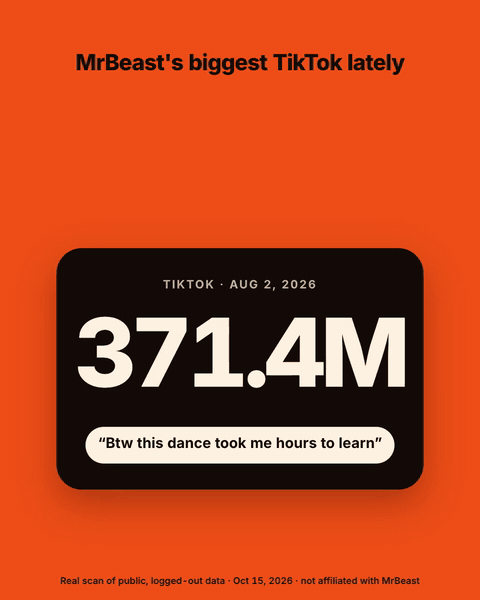

# social-scan

**A Claude Code skill that audits any creator's or brand's public Instagram, TikTok and YouTube in about a minute.** Hand it a handle and it finds the posts that broke out, shows the hooks that made them work, and tells you how much of the account rides on a few hits. No logins, no cookies, no paid analytics seat.

<p align="center"></p>

## What you get

You ask Claude: *"scan @duolingo's TikTok and YouTube."* About a minute later (53 seconds on this run; Instagram adds roughly 25 seconds) you get a report like this (real `scan` run with its defaults, public data, 2026-10-15):

| Group | Posts | Per week | Median views | Max | Top 3 share | Outliers 5x+ / 2-5x / 1.5-2x |
|---|---|---|---|---|---|---|
| TikTok | 60 | 6.1 | 685.0K | 18.00M | 35.2% | 5 / 13 / 4 |
| YouTube Shorts | 60 | 6.0 | 1.00M | 4.90M | 14.7% | 0 / 10 / 6 |
| YouTube long-form | 60 | 1.2 | 96.0K | 3.30M | 39.5% | 9 / 3 / 4 |

Plus, for every platform:

- **Outliers by lift.** Each post's views against that account's own median, sorted into huge (5x+), strong (2-5x) and mild (1.5-2x). Duolingo's top TikTok ran 26.3x its median.
- **Hooks, three ways.** For the top 3 and bottom 2 posts: the caption's opening line, the first 10 seconds of speech (transcribed locally with whisper.cpp), and the frame at 0.5 seconds.
- **Comment mining.** Top YouTube comments and the newest Instagram comments, handles stripped, ready to cluster into themes.
- **The numbers people skip.** Posting cadence, top-3 share (does the account live on a few hits?), followers per 1K views, and a flag when a gap in the data means a median can't be trusted.
- **A brief.** Claude reads the report and writes what worked, why it likely worked, and three content tests to run next.

Everything lands in the `--out` folder you give it, one per account: `summary.md`, `summary.json`, `posts.csv`, `hooks.json`, `comments.json`, the hook frames and the raw scrape files.

## Install

In Claude Code:

```
/plugin marketplace add moally310-byte/social-scan
/plugin install social-scan@social-scan
```

Or copy the skill folder by hand:

```bash
git clone https://github.com/moally310-byte/social-scan
cp -r social-scan/skills/social-scan ~/.claude/skills/
```

### Check your machine

Point `SCAN` at the script for your install, then run `doctor` (or ask Claude: *"is social-scan set up?"*).

Manual install:

```bash
SCAN=~/.claude/skills/social-scan/scripts/social_scan.py
python3 "$SCAN" doctor
```

Plugin install (the most recently installed version):

```bash
SCAN=$(ls -dt ~/.claude/plugins/cache/social-scan/social-scan/*/skills/social-scan/scripts/social_scan.py | head -1)
python3 "$SCAN" doctor
```

`doctor` checks each piece, says what a missing one turns off, and prints the install line for macOS and Linux with the command last on the line, so it pastes clean:

```
social-scan doctor

  PASS     python         3.14.8 at /opt/homebrew/bin/python3
  PASS     yt-dlp         2026.08.19 at /opt/homebrew/bin/yt-dlp
  MISSING  ffmpeg         not installed (optional)
                          turns off: first-frame images and spoken hooks
                          macOS: brew install ffmpeg
                          Linux: sudo apt install ffmpeg
  ...

YouTube and TikTok: ready.
Hooks: caption's first line only; no first frame, no spoken hook.
Instagram: off (optional; paid per use through Apify, about $0.11 per 40 reels; set APIFY_TOKEN to turn it on).
```

It exits 0 when YouTube and TikTok can run, which takes Python 3.8+ and [`yt-dlp`](https://github.com/yt-dlp/yt-dlp). On macOS, Homebrew's yt-dlp brings its own Python; on Linux, `doctor` prints yt-dlp's standalone build, which does too (the plain release needs Python 3.10+). Everything else is optional and adds to the report:

| Piece | Adds | Without it |
|---|---|---|
| `ffmpeg` | the frame at 0.5 seconds of each top and bottom post | hooks keep the caption opening only |
| `whisper-cli` ([whisper.cpp](https://github.com/ggml-org/whisper.cpp)) and the `base.en` model | the first 10 seconds of speech, transcribed on your machine | hooks keep the caption and the frame |
| `deno` | the JavaScript runtime yt-dlp recommends for YouTube | works for now; yt-dlp warns some YouTube formats may be missing |
| `APIFY_TOKEN` ([Apify](https://apify.com) account) | Instagram, paid per use | YouTube and TikTok only |

The whisper model (148 MB) never downloads on its own. `doctor --get-model` fetches `ggml-base.en.bin` to `~/.local/share/whisper-cpp/` (or to `WHISPER_MODEL`, if that path ends in the same file name) and checks its sha256 before saving it. On a Mac the whole set is:

```bash
brew install yt-dlp ffmpeg whisper.cpp
python3 "$SCAN" doctor --get-model
```

(Homebrew's yt-dlp pulls in deno.) Set `APIFY_TOKEN` in your own terminal; the skill never reads it from anywhere else and never prints it. Tools come from `PATH`; `YTDLP`, `FFMPEG`, `WHISPER_CLI` and `WHISPER_MODEL` point the script at others.

## Use it

Just ask Claude:

- "Scan @handle's socials before my pitch call."
- "What hooks are working for this creator on TikTok?"
- "Find their outlier reels."
- "Mine the comments on their top YouTube videos."

Or run it yourself. One command collects the posts, pulls the hooks and comments, and writes the report:

```bash
python3 "$SCAN" scan --out ./scans/duolingo --youtube @duolingo --tiktok duolingo --name "Duolingo"
```

- Use a new `--out` folder for each account: `scan` reports everything already in the folder, and its notes say when posts or follower counts came from an earlier run.
- `--instagram username` adds Instagram once `APIFY_TOKEN` is set.
- `--tiktok-followers 18300000` records TikTok's follower count, which isn't visible logged out (read it off the profile page). To add it after a run: `python3 "$SCAN" scan --out ./scans/duolingo --tiktok-followers N --no-hooks --no-comments`.
- A step whose tool is missing is skipped, the report still gets written, and the notes at the end say what was left out. The last line printed is the path to `summary.md`.

The single steps are still there for re-running one part, or for loading Instagram data pulled through the Apify MCP: `collect`, `ingest-ig`, `meta`, `hooks`, `comments`, `report`. `python3 "$SCAN" <step> --help` shows each one's flags.

## Cost

YouTube and TikTok are free. Instagram runs through Apify at about $0.11 for 40 reels, with a hard $0.30 cap on each Apify call built into the script (an Instagram run makes two calls: reels, then the profile).

## What it won't do

- **No logins.** Logged-out public data only. The script never passes cookies, runs yt-dlp with `--ignore-config` so a cookie setting can't sneak in from your own config, and never asks for anyone's password.
- **No private metrics.** Reach, retention, follows per post, traffic sources and ad spend only exist in the account owner's analytics. The skill ends with a checklist of what access to ask for.
- **Some blind spots.** TikTok comments don't load logged out. Instagram samples the reels tab only (photos and carousels aren't counted). LinkedIn, X, Threads and Facebook aren't covered yet.
- **Views aren't people.** Plays count replays, so treat views as plays, not unique viewers.

## Use it responsibly

This reads public, logged-out data only, but all three platforms' terms restrict automated access, so how you use it is on you. Comments are other people's words: the script strips handles, so keep it that way. The hook frames in `hooks/` are the account's own footage: keep them in your report folder and don't republish them.

## Status

- `doctor` and `scan` are tested on macOS (Python 3.8, 3.9 and 3.14; yt-dlp 2026.08.19, ffmpeg 8.1, whisper.cpp 1.9.1, deno 2.9.7): full runs, runs with ffmpeg, whisper-cli or yt-dlp taken off `PATH`, a mistyped handle, a reused `--out` folder, and `doctor --get-model` (a real download, plus simulated cut-off, bad-checksum, network and Ctrl-C failures).
- The Linux install lines follow each project's own docs (yt-dlp's standalone build, Ubuntu 26.04's `whisper.cpp` package or whisper.cpp's CMake build, apt for ffmpeg) but haven't been run on a Linux machine yet. If one trips, open an issue.
- YouTube, TikTok and Instagram (through the Apify MCP) are live-tested. The direct Instagram call (`--instagram`) is tested against a mocked Apify response; if your first live run trips on something, open an issue.

## Credits

The outlier tiers, hook breakdown, comment-mining method and brief template are adapted from ScrapeCreators' [social-media-research-skills](https://github.com/ScrapeCreators/social-media-research-skills) (MIT). Their skills run on the paid ScrapeCreators API; this one rewires the methods to yt-dlp, Apify and local whisper.cpp. See [THIRD_PARTY_NOTICES.md](THIRD_PARTY_NOTICES.md).

## License

MIT. Built by [Mo Ally](https://github.com/moally310-byte) with Claude Code.
